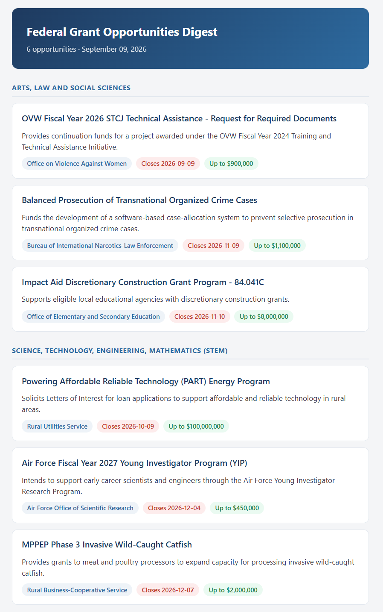
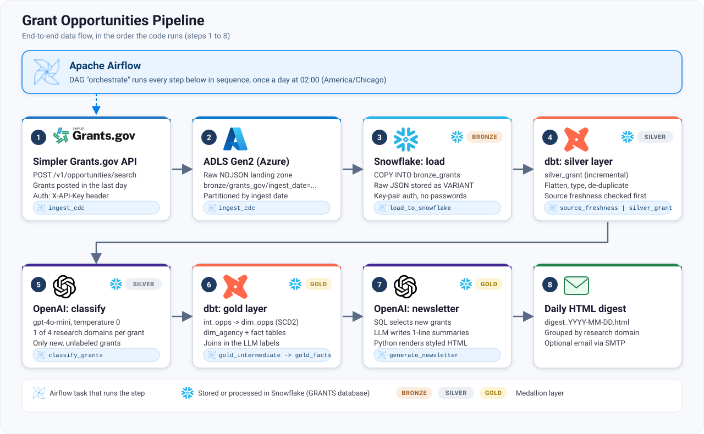

# Grant Opportunities Data Pipeline

An end-to-end data engineering project that ingests U.S. federal grant opportunities from [simpler.grants.gov](https://simpler.grants.gov), models them in Snowflake with dbt using a medallion architecture (bronze, silver, gold), classifies each grant into a research domain with an LLM, and produces a styled daily HTML newsletter. Apache Airflow orchestrates the whole thing.

## Sample Output



This is a real digest produced by the pipeline. Each grant is classified by the LLM, grouped by research domain, and shown with its agency, deadline and award ceiling. **[View the live sample digest](https://shariarn96.github.io/grant_pipeline/sample_digest.html)**. The source is in [`docs/sample_digest.html`](docs/sample_digest.html).

## Table of Contents

- [Overview](#overview)
- [Architecture](#architecture)
- [Tech Stack](#tech-stack)
- [Project Structure](#project-structure)
- [Pipeline Stages](#pipeline-stages)
- [Data Model](#data-model)
- [Design Decisions](#design-decisions)
- [Getting Started](#getting-started)
- [Running Components Individually](#running-components-individually)
- [Configuration Reference](#configuration-reference)
- [Future Improvements](#future-improvements)

## Overview

Researchers have to dig through thousands of federal funding listings to find ones relevant to them. This pipeline automates that:

1. **Ingests** newly posted grants from the Simpler Grants.gov API every day.
2. **Lands** the raw JSON in Azure Data Lake Storage (ADLS) and loads it into Snowflake.
3. **Transforms** it with dbt into clean, analytics-ready silver and gold tables.
4. **Enriches** each grant with a research-domain label (STEM, Health Sciences, and so on) using OpenAI.
5. **Publishes** a daily HTML digest of new opportunities, grouped by research domain.

## Architecture



### Airflow DAG

The `orchestrate` DAG runs daily at **02:00 America/Chicago**. Its tasks run strictly in sequence:

```
ingest_cdc
  -> load_to_snowflake
  -> source_freshness
  -> silver_grant
  -> classify_grants
  -> gold_intermediate
  -> gold_dimensions_agency
  -> gold_dimensions_opps
  -> gold_facts
  -> generate_newsletter
```

## Tech Stack

| Layer | Tool | Purpose |
|---|---|---|
| Orchestration | **Apache Airflow 3** | Schedules and sequences the pipeline using the TaskFlow API, `BashOperator` and `PythonOperator` |
| Source | **Simpler Grants.gov REST API** | Federal grant opportunity data |
| Data lake | **Azure Data Lake Storage Gen2** | Raw (bronze) landing zone, partitioned by ingest date |
| Warehouse | **Snowflake** | Bronze, silver and gold storage and compute |
| Transformation | **dbt Core + dbt-snowflake** | SQL models, snapshots, source freshness checks |
| Enrichment / NLP | **OpenAI API (`gpt-4o-mini`)** | Research-domain classification and newsletter summaries |
| Language | **Python 3.12+** | Ingestion, loading, LLM and newsletter code |
| Packaging | **uv / pyproject.toml** | Dependency management |
| Auth | **Key-pair auth (Snowflake)**, storage account key (ADLS), `.env` | Secrets and connection management |

Python libraries: `requests`, `azure-storage-file-datalake`, `snowflake-connector-python`, `openai`, `python-dotenv`, `pendulum`.

## Project Structure

```
grant/
├── airflow/
│   ├── dags/
│   │   └── orchestrate.py          # The main DAG
│   ├── digests/                    # Generated daily HTML newsletters
│   └── logs/                       # Airflow run logs
├── src/
│   ├── ingestion/
│   │   ├── ingest.py               # API -> ADLS (bronze)
│   │   ├── load_snowflake.py       # ADLS -> Snowflake (COPY INTO)
│   │   └── test.sql                # The COPY INTO statement
│   ├── llm/
│   │   ├── classifier.py           # LLM research-domain classification
│   │   ├── newsletter.py           # Styled HTML digest generator
│   │   └── news.py                 # Earlier plain-HTML digest variant
│   └── dbt_transform/grant/        # dbt project
│       ├── models/
│       │   ├── source/source.yml   # Source declarations
│       │   ├── silver/             # silver_grant (incremental)
│       │   └── gold/               # fact, dim_agency, ephemeral/int_opps
│       ├── snapshots/dim_opp.yml   # SCD Type 2 snapshot -> dim_opps
│       └── macros/custom_schema.sql
├── pyproject.toml
└── README.md
```

## Pipeline Stages

### 1. Ingestion: `src/ingestion/ingest.py`

- Calls `POST /v1/opportunities/search` on the Simpler Grants.gov API, authenticated with an `X-API-Key` header.
- Filters to opportunities with status `posted` and a `post_date` on or after the lookback date (`days_back`, default 1 day).
- Requests up to 100 records per call, sorted by post date, newest first.
- Writes the records as **newline-delimited JSON (NDJSON)** to ADLS at `bronze/grants_gov/ingest_date=YYYY-MM-DD/opportunities.json`.
- `overwrite=True` makes re-runs for the same day idempotent.
- Configuration is a frozen `dataclass` loaded from environment variables.

### 2. Load to Snowflake: `src/ingestion/load_snowflake.py`

- Connects to Snowflake with **RSA key-pair authentication**.
- Runs `COPY INTO bronze_grants` against the ADLS external stage (`@grants_stage_test`). It stores each raw JSON record in a `VARIANT` column along with the source filename and an ingestion timestamp.
- Snowflake's `COPY INTO` keeps load metadata, so files that were already loaded are skipped.

### 3. Silver layer: `silver_grant` (dbt)

- Flattens the raw `VARIANT` JSON into typed columns (IDs, agency info, award amounts, dates, eligibility, descriptions).
- Builds a canonical opportunity URL, falling back to the legacy grants.gov URL when needed.
- **Incremental** materialization with `unique_key = opportunity_id`. It only processes rows with a newer `ingestion_time`.
- **Deduplicates** with `ROW_NUMBER()` over `opportunity_id`, keeping the most recently updated record.
- Keeps lineage columns: `source_file`, `ingestion_time`, `silver_processed_at`.

### 4. LLM classification: `src/llm/classifier.py`

Each grant is assigned to exactly one research domain:

- Arts, Law and Social Sciences
- Science, Technology, Engineering, Mathematics (STEM)
- Health Sciences
- Multidisciplinary

How it works:

- **Incremental by default.** A `LEFT JOIN` against `silver.enrichment_grant_category` selects only grants that haven't been classified yet.
- **Constrained prompting.** The prompt supplies the title, summary and agency category, and the model must reply with exactly one label from the list. It runs at `temperature=0` with a tiny `max_tokens`, which keeps it cheap and repeatable.
- **Output validation.** Any answer outside the controlled vocabulary is fuzzy-matched back to a valid label or defaults to `Multidisciplinary`.
- **Fault tolerant.** If an API call fails, nothing is written for that row, so it is retried on the next run.
- **Batched writes.** Results are flushed to Snowflake every 50 rows.

### 5. Gold layer (dbt)

| Model | Type | Description |
|---|---|---|
| `int_opps` | ephemeral | Opportunity attributes joined with the LLM `research_domain` |
| `dim_opps` | snapshot (SCD Type 2) | Historical versions of each opportunity, built from `int_opps` |
| `dim_agency` | table | Distinct agencies and their top-level agency |
| `fact` | table | Opportunity-grain facts: `post_date`, `close_date`, `award_ceiling`, `award_floor`, agency key |

### 6. Newsletter: `src/llm/newsletter.py`

- **SQL decides what is relevant.** A deterministic query joins `fact`, `dim_opps` and `dim_agency`. It keeps posted opportunities from the current snapshot version (`dbt_valid_to = '9999-12-31'`) whose post date falls in the lookback window.
- **The LLM only writes language.** It produces one-sentence plain-English summaries as JSON, using only the supplied fields.
- **Python owns the design.** A styled HTML template renders cards grouped by research domain, with agency, deadline and award-ceiling tags.
- The Airflow task saves the digest to `airflow/digests/digest_YYYY-MM-DD.html`. The script can also send it over SMTP.

## Data Model

```
BRONZE
  bronze_grants              raw_data (VARIANT), source_file, ingestion_time

SILVER
  silver_grant               typed, deduplicated opportunities (dbt, incremental)
  enrichment_grant_category  opportunity_id, research_domain, enriched_at (LLM output)

GOLD
  fact                       opportunity_id, agency_code, post_date, close_date, award_ceiling, award_floor
  dim_agency                 agency_code, agency_name, top_level_agency_code, top_level_agency_name
  dim_opps                   SCD2 snapshot: opportunity attributes + research_domain,
                             with dbt_valid_from / dbt_valid_to
```

A custom `generate_schema_name` macro (`macros/custom_schema.sql`) and the `+schema` settings in `dbt_project.yml` place silver models in `silver` and gold models in `gold`. Silver models are materialized as views by default, with `silver_grant` overriding to incremental. Gold models are tables.

## Design Decisions

- **Medallion architecture.** Raw data is preserved untouched in bronze, cleaned in silver and modeled for consumption in gold.
- **Idempotent and incremental everywhere.** The ingestion upload overwrites by date partition. `COPY INTO` skips loaded files. The silver model is incremental with a unique key. LLM classification only touches unclassified rows.
- **SCD Type 2 on opportunities.** Grants change after posting (deadlines, amounts, status), so the snapshot keeps history using the `updated_at` timestamp strategy.
- **LLM used where it adds value and kept in a box.** Deterministic SQL selects the data, and the LLM only classifies or paraphrases. The prompts forbid outside knowledge, outputs are validated against a controlled vocabulary, and the newsletter layout is generated by code. This limits hallucination risk and keeps cost low.
- **Secrets stay out of the repo.** Credentials come from `.env`, the Snowflake private key and `profiles.yml` are git-ignored, and Snowflake uses key-pair auth.
- **Entry points designed for orchestration.** Each module exposes a plain callable (`ingest_opportunities`, `load_opportunities_to_snowflake`, `run_classification`, `generate_digest`) used by the DAG. Each can also run standalone.